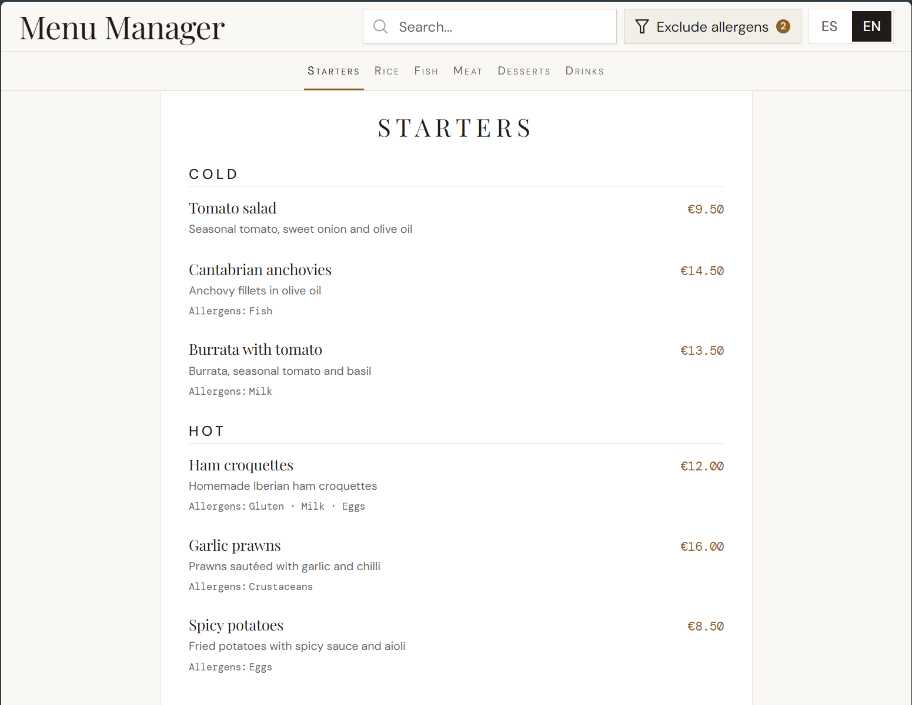

# MenuManager · Carta digital para un restaurante

Aplicación web para consultar y administrar la carta de un restaurante. Los comensales pueden consultar platos, precios y alérgenos en español o inglés; el personal autorizado puede cambiar precios y disponibilidad desde un panel de administración.

Desarrollo íntegramente realizado por [Vicente Marco](https://github.com/vCentDev), desde la interfaz Angular hasta la integración con Supabase para datos y autenticación. El proyecto está **en desarrollo y pendiente de entrega**; todavía no hay una URL pública en producción.

Este repositorio presenta el proyecto y su evolución. El código de la aplicación se mantiene por separado.

## Vista de la aplicación

Carta en escritorio con la interfaz en inglés: búsqueda, selección de alérgenos, navegación entre secciones y consulta de platos con sus precios y descripciones.

## Demostraciones en vídeo

Dos recorridos para conocer la carta pública y el acceso a la administración:

- **[Ver vídeo de la carta pública](https://github.com/user-attachments/assets/ab177397-51f7-490f-87f9-3db7471c0916)** — presentación del funcionamiento de la carta.
- **[Ver vídeo del login y la administración](https://github.com/user-attachments/assets/45ecbaa0-ee11-4daf-b2b7-b2360e13a22b)** — recorrido por el acceso y el panel administrativo.

## Alcance implementado

**Carta pública**

- Platos disponibles agrupados en secciones planas, con navegación por anclas.
- Búsqueda por nombre o descripción sin distinguir mayúsculas ni tildes.
- Exclusión de platos que contienen cualquiera de los alérgenos seleccionados.
- Interfaz y contenido en español e inglés, con preferencia de idioma guardada en el navegador y uso de la otra traducción cuando falta la solicitada.
- Estados de carga, error con reintento y ausencia de resultados.

**Administración**

- Inicio y cierre de sesión mediante Supabase Auth.
- Comprobación de sesión y rol de administrador antes de acceder al panel.
- Búsqueda, filtros y ordenación de platos.
- Edición de precios y disponibilidad con actualización optimista y recuperación del valor anterior si falla la escritura.
- Avisos de error de guardado y de traducciones ES/EN ausentes.

La carta pública conserva el orden definido por el restaurante; no ofrece un selector para ordenar por precio. Los cambios administrativos se consultan al volver a cargar la carta, sin sincronización Realtime de las páginas que ya están abiertas.

## Mi aportación y decisiones técnicas

He desarrollado la aplicación completa: carta pública, panel, autenticación, estado reactivo, adaptación de la interfaz a móvil y escritorio e integración con Supabase.

- **Estado con Angular Signals.** Los stores mantienen los datos y filtros, y calculan con `computed` las traducciones, los platos visibles y sus agrupaciones. El filtrado se realiza en el navegador sobre los datos cargados, sin paginación en las consultas actuales.
- **Modelos separados de las respuestas de Supabase.** Los clientes consultan los datos y los mapeadores transforman campos como `price_cents` en `priceCents` antes de utilizarlos en el estado y los componentes.
- **Edición optimista con gestión del fallo.** El panel muestra el nuevo precio o disponibilidad mientras guarda. Si la petición falla, el store restaura el valor anterior y la interfaz muestra un aviso. El modelo y las escrituras usan céntimos; el formulario permite introducir euros.
- **Traducción de interfaz y contenido por separado.** Los textos de controles y mensajes utilizan ngx-translate; las traducciones de platos, secciones y alérgenos se obtienen de Supabase.
- **Sesión y rol comprobados por separado.** Un guard comprueba la sesión y otro consulta el rol del perfil. Si no se puede confirmar el rol de administrador, se deniega la navegación al panel. La protección de los datos depende además de los permisos y políticas de la base de datos.

## Tecnologías

- **Angular 21.2 y TypeScript 5.9:** componentes standalone, Signals, Router y formularios.
- **PrimeNG 21 y PrimeUIX Themes:** controles y preset visual basado en Aura.
- **Supabase:** base de datos y autenticación mediante su cliente JavaScript.
- **ngx-translate 18:** traducción de los textos de la interfaz.
- **CSS:** estilos de componente, variables compartidas y fuentes locales DM Sans, Playfair Display y DM Mono.

## Estado y próximos pasos

La consulta de la carta y la edición de precios y disponibilidad están implementadas. Quedan pendientes el alta, la edición completa y el borrado de platos, la gestión de traducciones y alérgenos desde formularios y la gestión de secciones. La pestaña Secciones todavía muestra un mensaje provisional.

También están pendientes las migraciones y los datos iniciales para reproducir la base de datos, las pruebas automatizadas de los recorridos críticos y la integración continua.

La compilación de producción se comprobó el **31 de octubre de 2026** y terminó correctamente, con avisos por los presupuestos de tamaño del bundle inicial y los estilos del panel. El proyecto configura Jasmine y Karma, pero todavía no dispone de una suite de pruebas versionada; la prueba local revisada compiló, aunque no pudo ejecutarse porque Karma no consiguió iniciar ChromeHeadless.

La accesibilidad requiere una revisión integral. Hay una limitación conocida en el acceso mediante Tab al control de mostrar contraseña del login. Tampoco se presenta el estado actual como una validación exhaustiva de comportamiento o rendimiento.

## Autor y recursos

[Vicente Marco · Perfil de GitHub](https://github.com/vCentDev) — desarrollador Frontend especializado en Angular y TypeScript.

La interfaz utiliza componentes de PrimeNG, un preset basado en Aura de PrimeUIX Themes y las fuentes DM Sans, Playfair Display y DM Mono.
